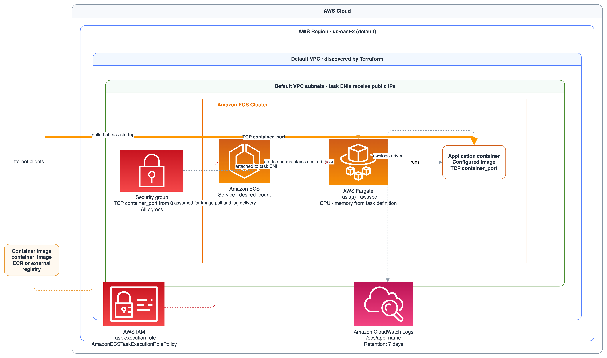

# AWS ECS Fargate with Terraform

## Components

- Create IAM role attached to ECS Task execution policy 
- Create Security Group for inbound access of Fargate containers
- Create ECS Cluster
- Create ECS Task definition
- Create ECS Service
- Create Cloud Map to integrate ECS to HTTP API Gateway

## Architecture

View the [AWS architecture diagram](ARCHITECTURE.drawio) or the [architecture overview](ARCHITECTURE.md).

