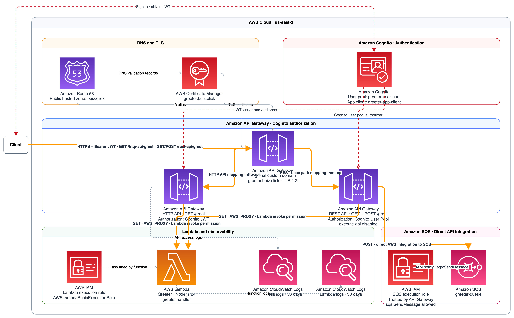

# cloud

## API Gateway (HTTP, REST) , Custom DNS, Route53, SQS Implementation using Terraform

See the [TerraformAws architecture diagram](TerraformAws/img.png) (editable in diagrams.net), or read the [TerraformAws setup guide](TerraformAws/README.md).

../TerraformAws/

## AWS ECS Fargate Implementation using Terraform 

../AWS_ECS_Terraform/
