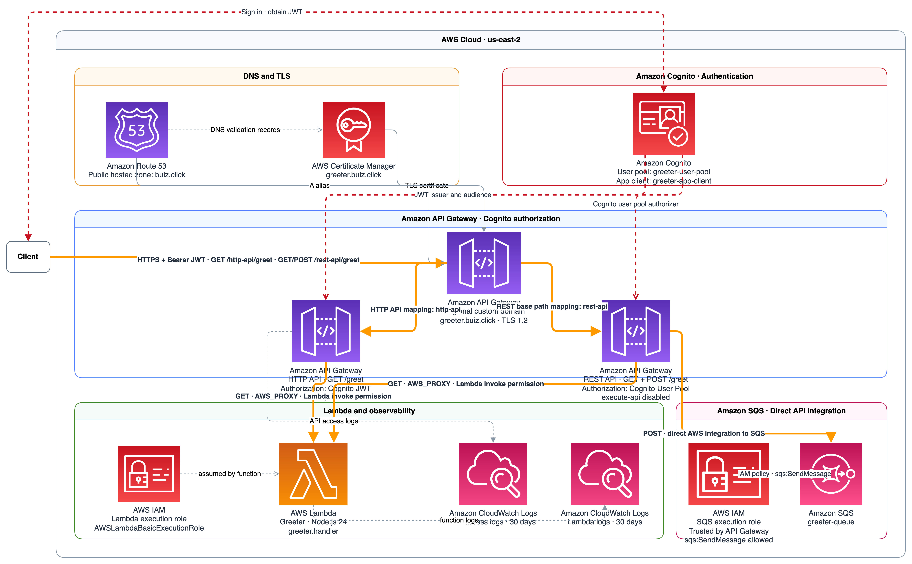

# AWS Resource creation using Terraform (Infrastructure as Code) 

See the [AWS architecture diagram](ARCHITECTURE.drawio) (editable in diagrams.net).

1. Create Policy, IAM, S3 
2. Create a Lambda function 
3. Create HTTP API Gateway
   - Test with:
     ```bash
     curl "$(terraform output -raw api_http_url)/greet?Name=Arnab"
     ```
4. Create REST API Gateway
   - Test with:
     ```bash
     curl "$(terraform output -raw api_rest_url)/greet?Name=Arnab"
     ```
5. Create Custom Domain Name
   - Buy domain name from Domain Registerer
   - Create DNS Zone using custom domain name in Route 53
   - Request an SSL Certificate from ACM
   - Create DNS records to validate the ACM certificate. 
   - Create the Custom Domain Name in API Gateway 
   - Map the custom domain to your API Gateway stage for HTTP and REST APIs. Test from the CLI:
     ```bash
     curl "$(terraform output -raw custom_domain_api_http_url)/greet?Name=Arnab"
     curl "$(terraform output -raw custom_domain_api_rest_url)/greet?Name=Arnab"
     ```
   - Disable direct access to API Gateway by setting this API Gateway property:
     ```hcl
     disable_execute_api_endpoint = true
     ```
6. Introduce authorization in API Gateway
     - Create Cognito User Pool & App Client (allows password login for testing/apps)
     - Create Test User
       ```bash
       aws cognito-idp admin-create-user \
         --user-pool-id <YOUR_USER_POOL_ID> \
         --username <USER_NAME> \
         --temporary-password <TEMP_PASSWORD> \
         --message-action SUPPRESS
       ```
         
       - Set a permanent password after the user's first sign-in:
         ```bash
         aws cognito-idp admin-set-user-password \
           --user-pool-id <YOUR_USER_POOL_ID> \
           --username <USER_NAME> \
           --password <NEW_PASSWORD> \
           --permanent
         ```
   
     - Generate JWT Bearer token 
       - AccesssToken is used for HTTP API
       - IdToken is used for Rest API
         ```bash
         aws cognito-idp initiate-auth \
         --client-id 5su70us5cj7t6kimttq8nijgtc \
         --auth-flow USER_PASSWORD_AUTH \
         --auth-parameters USERNAME=<USER_NAME>,PASSWORD=<PASSWORD>
         ```

     - Use the JWT in the Authorization header:
       ```bash
       curl -H "Authorization: Bearer <YOUR_ID_TOKEN>" "$(terraform output -raw custom_domain_api_http_url)/greet?Name=Arnab"
       ```


